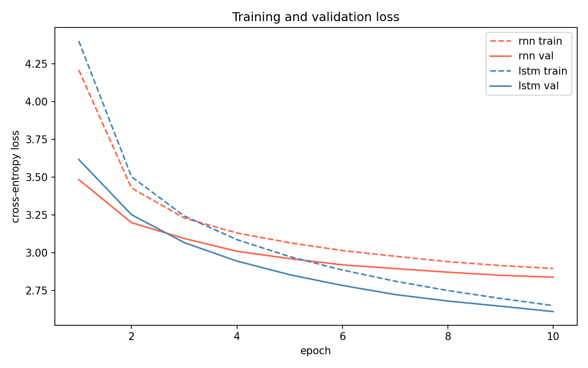

# Plot-Twist Generator: RNN vs LSTM

Oct 30, 2026 · @HajmolaBurger

## Summary

We trained a vanilla RNN and an LSTM language model on 20,000 TinyStories stories and used them to continue story openings. The LSTM is the better language model (test perplexity 13.40 vs 16.88) and loops less under greedy decoding, but neither model follows unusual prompts or produces a real plot twist.

Course: DSL 504 NLP, Group Assignment 2, Question 4. Seed 42 controls the data split and training; the Plot-Twist Challenge generator also sets the PyTorch seed to 42. The archived pooled metrics were produced by an earlier metrics script that did not explicitly seed generation; the revised script now does so on future runs.

## Data and preprocessing

Dataset: `roneneldan/TinyStories` (Hugging Face Datasets). The loader streams the `train` split and takes the first 22,000 records from that stream. Those records are then shuffled with seed 42 and partitioned by story record into 20,000 training, 1,000 validation and 1,000 test records. The validation and test sets are therefore project-created held-out subsets of the Hugging Face `train` split; they are not the dataset publisher's official validation or test splits.

| Split | Stories | Tokens | Avg length | `<unk>` rate | Truncated |
| --- | --- | --- | --- | --- | --- |
| Train | 20,000 | 3,483,783 | 174.2 | 0.22% | 32.7% |
| Val | 1,000 | 173,213 | 173.2 | 0.34% | 30.7% |
| Test | 1,000 | 174,787 | 174.8 | 0.34% | 32.2% |

- **Tokenisation:** lowercase word-level regex, curly quotes normalised.
- **Vocabulary:** built from the train split only, minimum frequency 5, 6,695 words. Special tokens: `<pad>`=0, `<unk>`=1, `<bos>`=2, `<eos>`=3.
- **Length:** stories are cut at 200 tokens. Cut stories get no `<eos>`.
- **Training pairs:** each story is `<bos> ... <eos>`; the input is the sequence without its last token and the target is the sequence shifted by one.
- **Why stories stay separate:** records are split before sequences are created. Joining stories before splitting could create artificial transitions and allow one source story to contribute sequences to more than one split.
- **Padding:** batches are padded with `<pad>`, and the loss ignores pad positions (`ignore_index`), so padding never counts as an error.
- **Known issue:** the cleaning left a few garbled characters (`€`, `™`) in the vocabulary, and they show up in some generated text.

## Models and training

Both models are Embedding → recurrent layer → Linear → vocabulary logits, built with `nn.RNN` and `nn.LSTM`. They share the data, vocabulary and settings below. The only difference is the recurrent layer.

| Setting | Value (both models) |
| --- | --- |
| Embedding / hidden size | 256 / 512 |
| Layers | 1 |
| Dropout | 0.2 |
| Optimizer | Adam, learning rate 1e-3 |
| Gradient clipping | 1.0 |
| Batch size | 64 |
| Max epochs / patience | 10 / 3 (early stopping on validation loss) |
| Loss | Cross-entropy, padding ignored |
| Seed | 42 |

| Metric | RNN | LSTM |
| --- | --- | --- |
| Parameters | 5,542,695 | 6,725,415 |
| Training time | 344 s | 473 s |
| Epochs run | 10 | 10 |
| Best validation loss | 2.8372 | 2.6092 |
| Validation perplexity | 17.07 | 13.59 |
| Test loss | 2.8261 | 2.5955 |
| Test perplexity | 16.88 | 13.40 |

The LSTM's validation loss is below the RNN's from about epoch 3. Early stopping never triggered, and validation loss was still falling at epoch 10, so both models are undertrained. Training loss starts above validation loss because it is averaged over the epoch with dropout on. Training times depend on the hardware used.

## Decoding

| Strategy | How it picks the next word |
| --- | --- |
| Greedy | Always the most likely word |
| Temperature | Divide the scores by T, then sample. We used T = 0.5, 0.8 and 1.2 |
| Top-k | Sample only from the k = 10 most likely words (T = 1.0) |

Settings: at most 80 new tokens, stop at `<eos>`, `<pad>` and `<bos>` blocked, seed 42. The general prompts are in `src/generate.py` and the twist prompts in `src/challenge.py`. Every run is saved as a JSON file in `results/`.

## Plot-Twist Challenge

We used seven twist openings: an exam paper with tomorrow's answers, a robot with a message from its future self, a detective solving a murder before it happens, a village forgetting the previous day, a letter from 100 years in the future, a new kid who knows everyone's secrets, and the moon moving closer to a village. Each was run with both models and three strategies (greedy, temperature 0.8, top-k 10), two samples each. That gives 84 records, but greedy is deterministic, so 70 are unique. Outputs were not edited.

We judged each output on four things: connection to the prompt, a meaningful twist, consistency, and repetition.

| Model, strategy | Prompt | Output (unedited) | Verdict |
| --- | --- | --- | --- |
| RNN, greedy | A detective solved a murder that had not happened yet. | he was very excited and wanted to play with it . he asked his mom , " what is that ? " the bird said , " i am a little girl . i am a little girl . i am a little girl . i am a little girl ... | Loses the prompt, then loops |
| RNN, greedy | The new kid at school knew everyone's secrets but had never met them. | he was so happy and he had a great time . | Ends early, no twist |
| LSTM, temperature 0.8 | The new kid at school knew everyone's secrets but had never met them. | it was the best day ever ! | Ends early, no twist |
| RNN, top-k | An old robot received a message from its future self. | they were going to play and play together . the end of its friends and they were both very tired . they had a fun time in the park and the sun was shining , and he was very happy . he had so much fun playing in the sand , but it was too late . the end . | Fluent but ignores the robot and the message |
| LSTM, greedy | Every night, the moon moved closer to the village. | the sun was shining and the sky was shining . the sun was shining brightly and the sky was full of bright colors . the sun was shining and the sky was so big and strong ... | Same idea repeated, moon forgotten |
| LSTM, temperature 0.8 | A letter arrived from one hundred years in the future. | it was a fun day and the west said € hello ! it was really nice . let € ™ s go back and see what is there ! ... | Broken characters, no twist |

(Long outputs are cut with "..." in this table only. The full text is in `results/plot_twist_challenge.json`.)

**What we saw**

- Relevance: almost every output drifts to a generic children's scene (a girl, a bird, a tree, a park). None that we found turned the premise into a real twist.
- Consistency: characters change mid-story (for example a robot becomes a little boy).
- Repetition: greedy decoding looped in 4 of 7 RNN outputs and 2 of 7 LSTM outputs.
- Failures kept in: loops, one-sentence endings, `<unk>` tokens and broken characters.

## Quantitative results

Higher diversity is not the same as a better story. Only the generated text is measured here (prompt removed). Distinct-1/2 is unique unigrams/bigrams divided by total. Repetition is 1 − unique 3-grams / total 3-grams, averaged per output. A loop is an output with repetition above 0.3.

**By strategy (Plot-Twist Challenge, unique outputs)**

| Model | Strategy | Outputs | Distinct-1 | Distinct-2 | Repetition | Loops |
| --- | --- | --- | --- | --- | --- | --- |
| RNN | Greedy | 7 | 0.166 | 0.308 | 0.363 | 4 |
| RNN | Temperature 0.8 | 14 | 0.339 | 0.754 | 0.002 | 0 |
| RNN | Top-k (10) | 14 | 0.286 | 0.723 | 0.003 | 0 |
| LSTM | Greedy | 7 | 0.197 | 0.420 | 0.211 | 2 |
| LSTM | Temperature 0.8 | 14 | 0.345 | 0.771 | 0.012 | 0 |
| LSTM | Top-k (10) | 14 | 0.294 | 0.710 | 0.021 | 0 |

**Temperature sweep (7 general prompts, one output each)**

| Model | Setting | Distinct-1 | Distinct-2 | Repetition |
| --- | --- | --- | --- | --- |
| RNN | Greedy | 0.106 | 0.184 | 0.528 |
| RNN | Temperature 0.5 | 0.350 | 0.706 | 0.072 |
| RNN | Temperature 1.2 | 0.560 | 0.964 | 0.000 |
| LSTM | Temperature 0.5 | 0.315 | 0.669 | 0.067 |
| LSTM | Temperature 0.8 | 0.453 | 0.824 | 0.031 |
| LSTM | Temperature 1.2 | 0.575 | 0.962 | 0.004 |

The two tables use different prompt sets, so compare within a table only.

**Pooled metrics (35 outputs per model: 7 general prompts × 5 settings; the original length measure includes the prompt)**

| Metric | RNN | LSTM |
| --- | --- | --- |
| Test perplexity | 16.88 | 13.40 |
| Distinct-1 | 0.189 | 0.205 |
| Distinct-2 | 0.480 | 0.544 |
| Mean 3-gram repetition | 0.103 | 0.084 |
| Average full-output length (words, prompt + continuation) | 70.8 | 78.9 |

The length values above are **not continuation-only lengths**. The generation function returns the prompt followed by the generated continuation, and the original metrics script counted words in that combined string. Therefore, 70.8 and 78.9 words include the opening prompt.

The original `under 20 words` count also used the combined prompt-plus-continuation text. It cannot reliably identify short or prematurely ended continuations because the prompt contributes 8–12 words before generation begins. It should not be interpreted as evidence that no continuation ended early.

**Supplemental continuation-only lengths from the saved Plot-Twist Challenge outputs**

To provide a prompt-excluded measurement without mixing sample sets, the following values were recomputed from all 84 saved challenge records (42 per model; 7 challenge prompts × 3 strategies × 2 samples). The exact prompt prefix was removed from each output before counting words with the same word-like-token pattern used by the metrics script. The two greedy samples for a given prompt are identical because greedy decoding is deterministic.

| Model | Challenge records | Mean continuation words | Median | Range | Continuations under 20 words |
| --- | ---: | ---: | ---: | ---: | ---: |
| RNN | 42 | 62.9 | 67.0 | 10–73 | 2 |
| LSTM | 42 | 68.4 | 70.5 | 6–74 | 1 |

These 84 challenge records are a different sample set from the 35 general-prompt outputs used in the pooled metrics table. The supplementary length figures must therefore be read separately, not combined with or substituted into that table. A continuation shorter than 20 words is only a length flag; it does not by itself prove that the model terminated prematurely or that the output is incomplete.

**Length-threshold limitation.** The generation cap is 80 new tokens. The original `180+ words` threshold is above the maximum practically reachable length for these short prompts, even when the prompt is included. Its zero count is expected by construction and is not evidence that the model avoids excessively long outputs. The generation code also does not save a stop-reason field, so the existing records do not distinguish stopping at `<eos>` from reaching the token cap.

The perplexity, diversity and repetition values above are retained from the archived `artifacts/metrics.json`; they were not regenerated during this report correction. The updated `src/metrics.py` now reports continuation-only length on the next run and seeds its sampling, but rerunning it would produce a new stochastic generation set. Each setting has few samples and one seed, so small differences are not reliable.

## Human evaluation

**Method.** 30 stories were sampled from the Plot-Twist Challenge outputs and shuffled (seed 42) as S01–S30. The CSV shows only the story text and sample ID, not the model or decoding strategy. The prepared rating sheet asks evaluators to score each sample from 1–5 for coherence, grammar, relevance to the prompt, and creativity/surprise. The key that links sample IDs to model and strategy is kept in a separate file. The 30 stories are not balanced: LSTM has 17 (temperature 6, top-k 6, greedy 5) and RNN has 13 (top-k 6, temperature 4, greedy 3).

**Who rated.** Not yet collected. All four rating fields for each of the 30 samples in `results/human_eval_blinded.csv` are blank. No evaluator count or human-rating result can be reported at this stage.

**Results.** Pending actual evaluator responses. The table below is intentionally left blank; no scores have been fabricated or inferred.

| Criterion | RNN average | LSTM average |
| --- | --- | --- |
| Coherence | – | – |
| Grammar | – | – |
| Relevance | – | – |
| Creativity / surprise | – | – |

**Disagreement between raters and with perplexity.** Pending actual ratings. It is not yet possible to calculate evaluator disagreement or compare human scores with the lower LSTM perplexity.

## Dataset split provenance and run environment

**What the code establishes.** `src/data.py` calls `load_dataset("roneneldan/TinyStories", split="train", streaming=True)`, takes the first 22,000 records from that stream, and shuffles those records using `random.Random(42)`. It then slices the shuffled list into 20,000 training, 1,000 validation and 1,000 test story records. Tokenization and conversion into next-token sequences happen after this partitioning. The three project splits are thus disjoint slices of the selected record list by construction; the official Hugging Face validation and test splits are not used.

**Leakage status.** The inspected code does not demonstrate actual train/validation/test leakage: it partitions story records before creating token sequences and does not intentionally reuse a list entry across splits. However, the archive does not retain upstream story IDs, a dataset revision/commit, or an exact/near-duplicate audit. Duplicate or near-duplicate text appearing as separate source records therefore cannot be ruled out. The defensible conclusion is that leakage has **not been established** from the available evidence; it would be inaccurate either to claim that leakage occurred or to claim that every possible form of duplicate leakage was ruled out.

**Dataset revision and provenance limits.** The dataset identifier is recorded as `roneneldan/TinyStories`, but no Hugging Face revision/commit hash or streamed-record IDs are saved. The exact first 22,000 records may consequently depend on the upstream dataset revision and streaming order available when preprocessing ran. `artifacts/data_stats.json` preserves aggregate split sizes and token statistics, not source record identifiers.

**Original runtime environment.** The code selects CUDA when `torch.cuda.is_available()` is true and otherwise uses CPU. The saved training histories contain the seed, parameter count, loss/perplexity history and elapsed training seconds, but do not identify the actual device, GPU/CPU model, Python version, PyTorch version, CUDA version, or `datasets` version. `requirements.txt` lists package names without version pins. `COLAB_STEPS.md` describes a suggested T4-GPU workflow; it is not a record that the original training run used a T4. The original runtime environment is therefore only partially documented and cannot be reconstructed from this archive alone. Add exact hardware/software versions only from the original notebook or run logs; do not infer them from the instructions.

## Final analysis

**1. How do RNN and LSTM differ?** The LSTM predicts text better: test perplexity 13.40 vs 16.88. Its gates help it keep information longer. It costs about 21% more parameters and 38% more training time. Both were still improving at epoch 10.

**2. Which is more coherent and less repetitive?** The LSTM is less repetitive, mostly under greedy decoding (repetition 0.211 vs 0.363; 2 vs 4 looping outputs out of 7). Both ignore the unusual prompts and write generic stories. Human coherence ratings have not yet been collected; the Human evaluation section remains pending.

**3. How does temperature affect creativity and grammar?** Higher temperature gives more varied words but worse grammar. At 0.5 the text is readable but samey. At 0.8 it is a good balance. At 1.2 it falls apart, for example: "it waited what was jane standing in the blue - \<unk> sparkling coming water".

**4. Do high diversity scores guarantee better stories?** No. Temperature 1.2 has the highest diversity (Distinct-2 about 0.96) and the worst text. Diversity counts unique words, not whether they make sense.

**5. Does lower perplexity mean better storytelling?** Only a little. The LSTM loops less and reads more smoothly, but neither model follows the prompt or makes a real twist. The human-rating comparison remains undetermined because the rating fields are still blank.

**6. What failures are most common, and how could they be reduced?**

- Ignoring the prompt: more data and training, or conditioning on the prompt.
- Repetition loops (greedy): a repetition penalty, or sampling instead of greedy.
- Characters changing mid-story: a bigger model and longer training.
- Gibberish at high temperature: use temperature 0.8 or top-k.
- Broken characters and `<unk>`: fix the text cleaning and retrain.

These fixes were not tested in our experiments.

**7. Limitations**

- Small data: 20,000 stories and a word-level vocabulary of 6,695 words.
- Undertrained: 10 epochs and one seed (42).
- Stories cut at 200 tokens and outputs cut at 80 tokens.
- The models predict one word at a time and do not plan a plot, so real twists are unlikely.
- Small evaluation: 7 prompts and few samples per setting. Thirty blinded rating rows are prepared, but their rating cells are blank, so human evaluation is not yet complete.

## Conclusion

The LSTM is the stronger language model on the recorded test perplexity (13.40 vs 16.88) and has a lower measured repetition rate. Temperature 0.8 or top-k gave the more readable examples in the inspected samples, while very high temperature produced gibberish and greedy decoding often looped. Neither model reliably turned the twist prompts into meaningful plot twists, so lower perplexity and higher diversity should not be read as proof of better storytelling. Both models are undertrained, the results come from one seed and small samples, and human ratings remain uncollected.

To reproduce: see the README. Code, checkpoints, vocabulary and all generated outputs are in the submitted archive.
